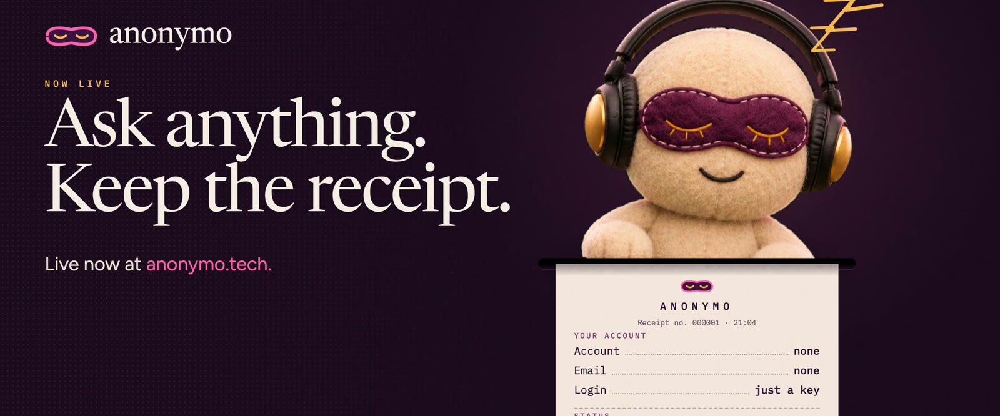

<p align="center">
  <a href="https://anonymo.tech"></a>
</p>

<p align="center">
  <a href="LICENSE"></a>
  <a href="#licence"></a>
  <a href="https://anonymo.tech"></a>
  
  
  
  
</p>

**Anonymo** is one OpenAI-compatible API key for low-refusal models: chat, code and images. There is no account and no
email. You get a key, top it up with stablecoins, and every answer comes with a signed receipt.

Live at [anonymo.tech](https://anonymo.tech). The API is at `https://api.anonymo.tech/v1`.

> **Adults only (18+).** Anonymo is for adults. A safety floor checks every prompt and every reply, and anything it
> blocks is refused with HTTP 451. It is never sent to another model.

## What it does

| | |
|---|---|
| **No account** | A key is the whole login. No email, no name, no password. Prompt text is never stored. |
| **Refusals rerouted** | If a model refuses a legal request, the router sends it to a different model family and refunds the refused attempt. |
| **Signed receipts** | Every call returns a receipt: which route answered, what it cost, and a signature anyone can check. |
| **Council** | `anonymo-council` asks several models and merges their answers. |
| **Images** | An image studio with a nudity check on the prompt and two checks on every output. Images are safe for work. |
| **Pay in crypto** | Deposit USDG on Robinhood Chain, or USDC/USDT on Base and Arbitrum. Spend limits per key: daily, monthly, lifetime. |
| **On your device** | Saved chats, recaps and the wipe button live in your browser, not on our servers. |

## What's in this repo

| Path | What it is |
|---|---|
| [`gateway/`](gateway/) | The API: router, ledger, receipts, the safety floor, council, `/v1/messages`, images, deposits. Bun · Hono · Drizzle · Postgres · Redis · viem |
| [`gateway/contracts/`](gateway/contracts/) | The deposit contracts: `DepositRouter` behind a 48-hour timelock, same address on every chain. Foundry |
| [`dash/`](dash/) | The web workspace at anonymo.tech: chat, images, keys, funds, usage and receipts |

## Run it

```bash
cd gateway && bun install && bun run launch   # mock providers, local database, API with a funded test key
```

```bash
cd dash && pnpm install && pnpm dev           # the workspace (pnpm 11.19, Node 22.13+)
```

Tests: `bun test` and `bun run typecheck` in `gateway/`, `forge test` in `gateway/contracts/`, `pnpm test` in `dash/`.

## Security

Please report vulnerabilities privately. See [SECURITY.md](SECURITY.md).

## Licence

Source-available, **non-commercial use only**: [PolyForm Noncommercial 1.0.0](LICENSE). See [NOTICE](NOTICE).
`dash/` keeps its own source-available licence ([`dash/LICENSE`](dash/LICENSE)). Solidity files marked MIT stay MIT,
and third-party code keeps its own licence. For commercial use, open an issue.
