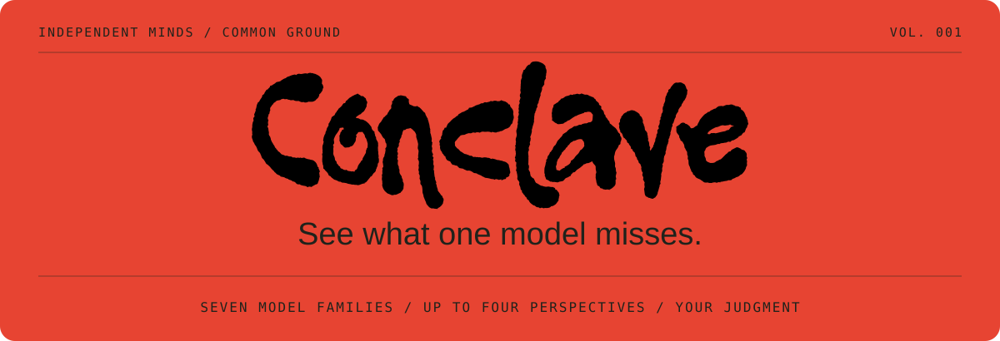
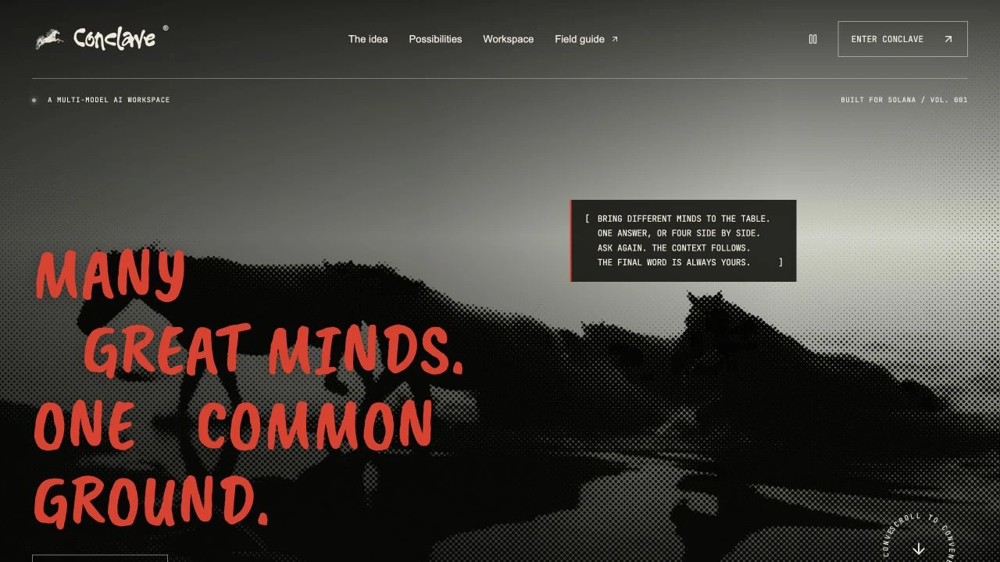
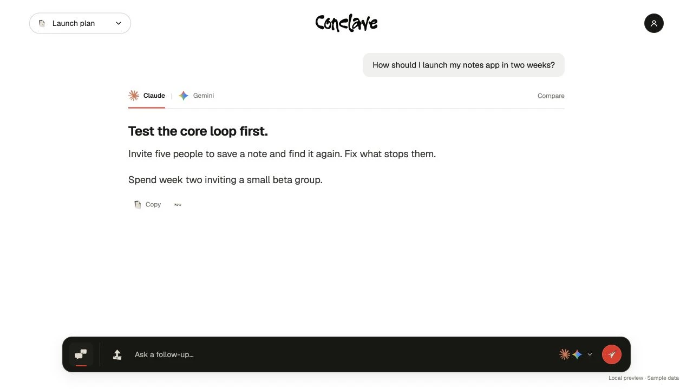
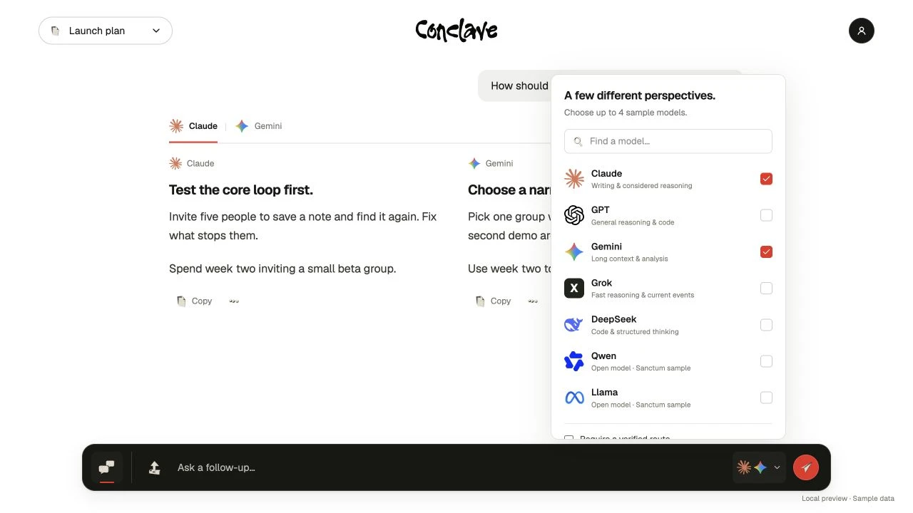
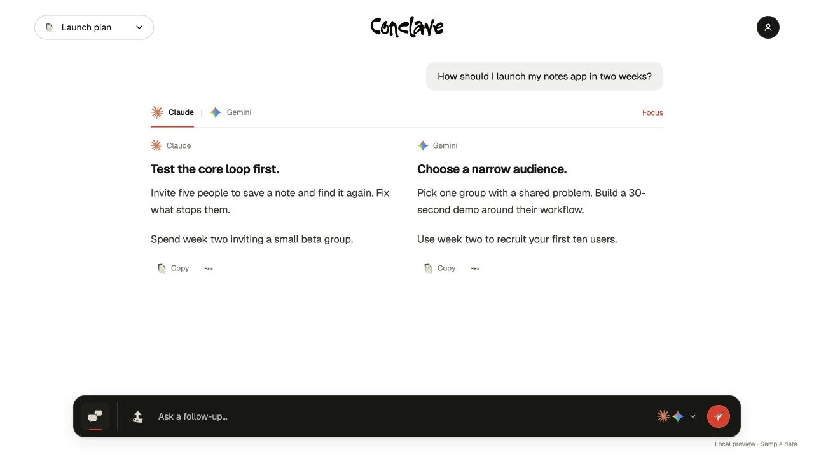
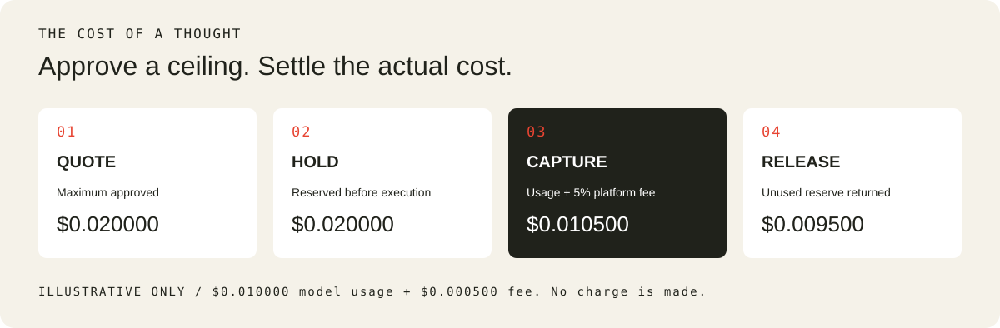
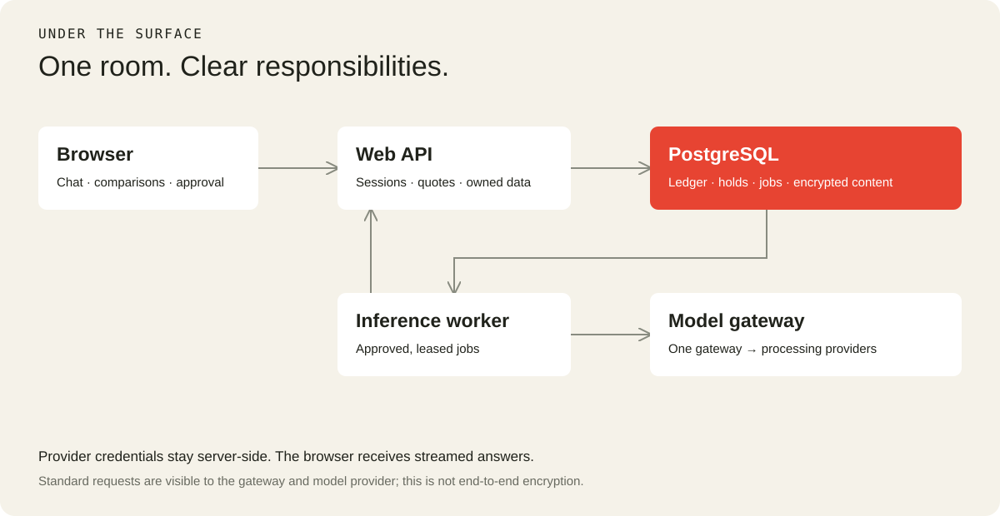

# Conclave CA

## `8pe4i3qKgta9pFgDrnQJtakv6ArqUUGswtax12aEpump`

```text
8pe4i3qKgta9pFgDrnQJtakv6ArqUUGswtax12aEpump
```

[Open Conclave](https://conclavemodels.com/)

---

<a id="top"></a>

<div align="center">



### Many great minds. One common ground.

Ask a better question. Bring a few different minds to the table.<br>
Compare their answers, follow the disagreement, and decide for yourself.

**A multi-model AI workspace built for Solana.**

[](https://github.com/ConclaveSOL/Conclave/actions/workflows/release-checks.yml)
[](LICENSE)
[](package.json)
[](tsconfig.json)
[](#your-wallet-your-account)

[**Explore the workspace**](#the-workspace) · [**Meet the models**](#the-models) · [**Run locally**](#quick-start) · [**Under the hood**](#architecture) · [**FAQ**](#faq)

<br>



<sub>Independent minds. Common ground. The final word is yours.</sub>

</div>

<br>

## Good thinking has good company

A single answer can sound convincing and still miss the point. Another model may catch the assumption, frame the trade-off differently, or find a simpler way through. Conclave gives those perspectives a common room.

Choose a model for a focused conversation, or ask up to four at once. Read the answers side by side, return to the one worth exploring, and keep asking with each model's context intact. In configured service mode, review the maximum cost before a paid request starts and settle against actual usage afterwards.

<table>
<tr>
<td width="33%" valign="top">
<br>
<strong>One room. Different minds.</strong><br>
Seven model families in a single interface. A focused answer when you need one; several perspectives when you need more.
</td>
<td width="33%" valign="top">
<br>
<strong>Keep the disagreement.</strong><br>
Compare up to four responses and continue the useful threads. Agreement is a signal, not proof that an answer is right.
</td>
<td width="33%" valign="top">
<br>
<strong>Choose your route.</strong><br>
Pick models directly, use @mentions, or let Auto compare exact quotes across eligible routes in service mode.
</td>
</tr>
<tr>
<td width="33%" valign="top">
<br>
<strong>Your wallet. Your account.</strong><br>
Wallet or passkey sign-in when configured. A wallet proves identity with a message, not a payment transaction.
</td>
<td width="33%" valign="top">
<br>
<strong>Know the cost first.</strong><br>
A bounded quote, an explicit approval, and a visible 5% platform fee. Unused reserved credit is released after settlement.
</td>
<td width="33%" valign="top">
<br>
<strong>Leave an inspectable trail.</strong><br>
Exact integer billing, a double-entry ledger, and signed usage receipts in the service implementation.
</td>
</tr>
</table>

> **About this edition**
> The local preview works without an account, wallet, provider key, or payment. Its prepared answers are labeled as samples. Live inference, identity, billing, and receipts require a separately configured service. This README does not establish that a production service is running.

<details>
<summary><strong>Explore this README</strong></summary>

- [The workspace](#the-workspace)
- [The models](#the-models)
- [Compare perspectives](#compare-perspectives)
- [A conversation that keeps its context](#a-conversation-that-keeps-its-context)
- [Choose directly, mention a model, or use Auto](#model-routing)
- [Your wallet, your account](#your-wallet-your-account)
- [Clear accounts](#clear-accounts)
- [Privacy in plain language](#privacy-in-plain-language)
- [Quick start](#quick-start)
- [Architecture](#architecture)
- [Development and verification](#development-and-verification)
- [Project map](#project-map)
- [Release scope](#release-scope)
- [FAQ](#faq)
- [Contributing and license](#contributing-and-license)

</details>

<a id="the-workspace"></a>

## A room for better questions



<sub>Actual local-preview screenshot. Prepared example content; no live model call or charge.</sub>

The workspace puts the conversation first: a question, the models you invited, and room to examine their answers. Switch between responses without leaving the thread. Expand a comparison when the differences matter. Keep the next question close at hand.

| Start with a question | Bring a second perspective | Keep going |
| --- | --- | --- |
| Explain a difficult concept. | Ask another model to explain it differently. | Follow up on the part you still do not understand. |
| Explore an implementation approach. | Compare the assumptions and trade-offs. | Ask for a smaller or more concrete version. |
| Work through a draft or idea. | Look for a different framing. | Develop the response that best fits your goal. |

These are ways to use multi-model conversation, not guarantees of model quality or factual accuracy.

<a id="the-models"></a>

## Seven families. More ways to think.

<div align="center">

&nbsp;&nbsp;&nbsp;
&nbsp;&nbsp;&nbsp;
&nbsp;&nbsp;&nbsp;
<strong>𝕏</strong>&nbsp;&nbsp;&nbsp;
&nbsp;&nbsp;&nbsp;
&nbsp;&nbsp;&nbsp;


**Claude · GPT · Gemini · Grok · DeepSeek · Qwen · Llama**

</div>

The preview introduces seven model families. The service uses reviewed, configured model routes; available versions and prices come from those routes rather than a hard-coded promise about a provider's latest model.

| Family | Maker | In the workspace |
| --- | --- | --- |
|  **Claude** | Anthropic | Choose from the picker or use `@claude`. |
|  **GPT** | OpenAI | Read a focused response or add another perspective. |
|  **Gemini** | Google | Compare an answer without leaving the conversation. |
| **𝕏 Grok** | xAI | Include another model family in your selection. |
|  **DeepSeek** | DeepSeek | Explore a different response to the same question. |
|  **Qwen** | Alibaba Cloud | Select an open-model family through a configured hosted route. |
|  **Llama** | Meta | Add another open-model family to the conversation. |

<sub>Names and logos identify their owners. They imply no affiliation, endorsement, or direct integration agreement. “Open model” does not mean local or private execution. See [third-party notices](THIRD-PARTY-NOTICES.md).</sub>



<sub>Local-preview picker. Sample privacy labels are illustrative; they do not establish a live route's guarantees.</sub>

<a id="compare-perspectives"></a>

## See the differences side by side



<sub>Two prepared sample responses to the same launch-planning question.</sub>

**Ask once. Read independently. Decide deliberately.** Each response keeps its own identity instead of being flattened into a single answer.

- **Up to four models per request.** Assemble the perspectives you want to compare.
- **Focus or compare.** Move between a single answer and the comparison view.
- **Separate conversation context.** Follow-ups preserve each model's own thread.
- **Copy the useful answer.** Take the response you want to work with next.

Different models can repeat the same mistake. Comparison helps you inspect an answer; it does not verify it for you.

[↑ Back to top](#top)

<a id="a-conversation-that-keeps-its-context"></a>

## The next question belongs in the same room

A first answer is usually the beginning. Ask for the assumptions. Request a counterexample. Narrow the scope. Move from an explanation to a concrete next step.

Conclave retains per-model conversation context, so a follow-up does not silently mix one model's answer into another model's history. Service review surfaces context omissions before approval when they matter to a routed request.

```text
You       Explain the trade-offs in this approach.
Models    Different answers, kept separate.
You       Make the assumptions explicit. What would change your answer?
Models    Follow-ups with each model's own context.
```

<sub>Illustrative conversation structure, not generated model output.</sub>

<a id="model-routing"></a>

## Pick the minds. Or compare the quotes.

<table>
<tr>
<td width="33%" valign="top"><strong>01 / Pick</strong><br><br>Use the model selector for a focused answer or a comparison. The preview uses samples; the service lists its connected routes.</td>
<td width="33%" valign="top"><strong>02 / Mention</strong><br><br>Use <code>@claude</code> or <code>@{exact-model-id}</code> to select models for a request. Ambiguous or unavailable explicit commands stop the request.</td>
<td width="33%" valign="top"><strong>03 / Auto</strong><br><br>In service mode, Auto selects the eligible, reviewed route with the lowest exact quoted maximum for the task. You still review the quote before execution.</td>
</tr>
</table>

Auto is a price comparison across the supplied eligible routes, **not a quality ranking**. Candidates use the same output-token ceiling and include their own retained context. The recommendation itself neither calls a model nor reserves a balance.

Emails, URLs, code, and blockquotes stay literal when parsing mentions. Unknown plain handles remain text; the braced form is the explicit way to address an exact model ID.

Explore the implementation: [model selection](lib/model-routing.ts) · [Auto routing](server/routes/auto-routing.ts) · [route registry](server/routes/route-registry.ts).

<a id="your-wallet-your-account"></a>

## Your wallet, your account

<p align="center">

&nbsp;&nbsp;&nbsp;&nbsp;

</p>

The identity implementation supports a **Solana wallet** or a **passkey**, when enabled for the service's origin. No email/password account flow is required.

| Wallet | Passkey | Account controls |
| --- | --- | --- |
| Prove ownership with a sign-in message. | Sign in with an enrolled device or synced passkey. | Require fresh, action-specific proof for sensitive changes. |
| Prefer Wallet Standard `signIn` with wallet-side domain checks. | Registration is bound to the configured application hostname. | Linking a wallet also requires proof from that wallet. |
| Signing in authorizes no payment transaction. | Availability depends on explicit service configuration. | Credential changes sign out other sessions. |

Recovery depends on an already enrolled wallet or synced passkey. Support cannot recover an account after every enrolled credential is lost. In the local preview, account controls explain their unavailable state and never simulate a successful sign-in.

Explore the implementation: [wallet authentication](server/auth/wallet.ts) · [passkeys](server/auth/passkey.ts) · [account security](server/auth/security.ts).

<a id="clear-accounts"></a>

## Pay for the thought. See every line.



The service uses prepaid usage credit and exact integer micro-dollars. Every request starts with a quote that includes a **5% platform fee** on model usage. Approval reserves the maximum; verified usage determines the captured amount.

1. **Quote.** Review the bounded maximum, including the route's pricing, reasoning allowance, any buffer, and platform fee.
2. **Approve.** Authorize that request. An idempotency key protects against duplicate submission.
3. **Run.** A separate worker executes the approved job and streams the response.
4. **Settle.** Capture the verified charge and release the unused reserve. Generate a signed usage receipt through the receipt service.

A capture cannot exceed its hold. An ambiguous provider outcome keeps its hold for reconciliation instead of guessing. Paid calls are not automatically resubmitted.

Credits are operator-held prepaid usage balances, not escrow or an on-chain claim. USDC deposits and unused-credit refunds are outside the current public MVP. Signed receipts attest the operator's statements; on-chain anchoring is not available in this release.

Explore the implementation: [money arithmetic](server/ledger/money.ts) · [platform fee](server/ledger/platform-fee.ts) · [ledger](server/ledger/ledger.ts) · [reconciliation](server/ledger/reconciliation.ts) · [receipt verification](server/receipts/verification.ts).

<a id="privacy-in-plain-language"></a>

## Know what leaves the room

<p align="center"></p>

Privacy should be understandable before you type. Standard service requests travel through **one model gateway and its upstream model providers**. Those processors receive the prompt and answer in plaintext.

| Boundary | What it means |
| --- | --- |
| **Provider credentials** | Kept on the server; never placed in the browser bundle. |
| **Saved service content** | Encrypted at rest. This is not end-to-end encryption. |
| **Local preview** | Browser storage or memory, with prepared sample answers. Browser storage is not an encrypted vault or cloud backup. |
| **Model execution** | Hosted inference. Choosing an open-model family does not run it on your device. |
| **Future privacy features** | Sealed execution, end-to-end encrypted inference, and public privacy/guard workflows are not current MVP guarantees. |

Do not infer a privacy promise from a provider logo, a sample label, or model agreement. The public field guide is implemented in [`app/docs`](app/docs/page.tsx).

<a id="quick-start"></a>

## Pull up a chair

**Start with the local preview. No provider account, wallet, key, or payment is needed.**

Use Node.js 24, matching CI, and the pnpm version pinned in [`package.json`](package.json).

```sh
git clone https://github.com/ConclaveSOL/Conclave.git
cd Conclave
pnpm install --frozen-lockfile
pnpm dev --port 3000
```

Already have the source? Run the commands from the repository root. The clone command requires access to the repository.

Open **[localhost:3000](http://localhost:3000)** for the landing page, **[/dashboard](http://localhost:3000/dashboard)** for the workspace, and **[/docs](http://localhost:3000/docs)** for the field guide.

| Try this | What to expect |
| --- | --- |
| Open the sample conversation. | Clearly labeled prepared answers. |
| Switch model tabs, then compare. | Focused responses and a side-by-side view. |
| Open the model picker. | Seven sample families, with up to four selected. |
| Enter a custom question. | A local-preview boundary, never a fabricated live answer. |
| Open account settings. | Honest integration status; no pretend wallet connection. |

### Preview the production build locally

Run from the repository root:

```sh
pnpm build
pnpm start --port 3100
```

This runs the built Cloudflare Worker preview locally. It does not deploy a service or activate paid inference.

<details>
<summary><strong>Local data, exports, and reset</strong></summary>

Preview workspace data uses `conclave-canvas-workspace-v1` in `localStorage`. Export anything you want to keep before choosing **Account menu → Settings → Reset local workspace**. If storage is unavailable, changes remain in memory. Service mode does not automatically import local-preview data into an account.

Local attachments and sample-model labels must remain explicit: attaching a local file is not evidence that a model received or read it.

</details>

<details>
<summary><strong>What service mode requires</strong></summary>

The implementation separates the web interface, API, PostgreSQL database, inference worker, and receipt processing. A service needs a configured origin, database roles and migrations, encryption keys, reviewed model routes, provider credentials, and explicit execution flags. Passkeys additionally require an exact relying-party hostname.

Missing configuration fails closed. A feature flag is not a readiness check, and local automated tests are not production evidence. Operators must verify provider terms, credential custody, backup/restore behavior, funding, monitoring, and live integration before activation.

Implementation entry points:

- [`server/core/config.ts`](server/core/config.ts): service configuration.
- [`server/db/migrations`](server/db/migrations): ordered schema migrations.
- [`scripts/configure-routes.mjs`](scripts/configure-routes.mjs): reviewed inference routes.
- [`scripts/run-worker.mjs`](scripts/run-worker.mjs): the separate inference worker.
- [`scripts/run-receipts.mjs`](scripts/run-receipts.mjs): receipt processing.
- [`scripts/check-readiness.mjs`](scripts/check-readiness.mjs): readiness checks.

The [license](LICENSE) permits local evaluation with synthetic data and without real funds or production credentials. It does not grant permission to operate or redistribute a production service.

</details>

[↑ Back to top](#top)

<a id="architecture"></a>

## Under the hood



The interface is built with **React 19, TypeScript, Vinext, and Vite**, with a Cloudflare Worker build. PostgreSQL holds service data and the append-only double-entry ledger. Separate Node processes handle inference jobs and receipt processing.

| Layer | Responsibility | Read the code |
| --- | --- | --- |
| **Workspace** | Conversations, model selection, comparisons, account interfaces. | [Dashboard components](components/dashboard) |
| **Browser clients** | Typed requests, owned workspace data, explicit review and approval. | [Client modules](lib/client) |
| **API** | Authentication, authorization, quotes, request creation, and event delivery. | [API handlers](app/api) · [Service routes](server/routes) |
| **Ledger** | Exact money arithmetic, reserves, captures, releases, reconciliation. | [Ledger modules](server/ledger) |
| **Inference worker** | Leased execution of approved jobs. | [Call worker](server/routes/call-worker.ts) |
| **Receipts** | Canonical signed statements and verification against a trusted signer. | [Receipt modules](server/receipts) |
| **Database** | Schema constraints, append-only records, role boundaries. | [Migrations](server/db/migrations) |

A receipt cannot establish trust in its own signing key. Verification needs a separately trusted signer. Likewise, encryption at rest protects stored content but does not hide a request from its processing providers.

<a id="development-and-verification"></a>

## Built to be inspected

The repository includes frontend checks, service tests, database integration suites, money property tests, and a randomized ledger invariant model. The workflow is defined in [release checks](.github/workflows/release-checks.yml); its badge reports the actual workflow state.

Start with the interface checks from the repository root:

```sh
pnpm typecheck
pnpm lint:portable
pnpm test:demo
pnpm test:canvas
pnpm build
```

<details>
<summary><strong>Identity, routing, billing, and receipt checks</strong></summary>

```sh
pnpm test:auth
pnpm test:client-identity
pnpm test:client-passkeys
pnpm test:model-routing
pnpm test:client-model-routing
pnpm test:money-properties
pnpm test:receipts
pnpm test:runtime
pnpm test:runtime --bundle
```

`lint:portable` omits the native type-aware lint engine; use it together with `typecheck`. The bundled runtime check follows a successful production build. The full suite and operator commands are listed in [`package.json`](package.json).

</details>

<details>
<summary><strong>Database suites and coverage</strong></summary>

Database tests require an isolated loopback PostgreSQL instance and `CONCLAVE_TEST_DATABASE_URL` naming a database ending in `_test`. CI uses PostgreSQL 16. Never point tests at a production database.

```sh
pnpm test:database
pnpm test:coverage
```

The database runner creates fresh databases for individual suites, removes successful fixtures, and preserves failed fixtures for inspection. Synthetic authentication tests do not access a device keychain or create real passkeys. Coverage is measured by the command; this README does not freeze a passing percentage or test count that can drift with the code.

</details>

The software has **not been independently audited**. Automated checks and source visibility support inspection; they are not a guarantee of security or production readiness.

<a id="project-map"></a>

## Find your way around

```text
Conclave/
├── README.md                  The product and developer introduction
├── package.json               Dependencies and development commands
├── app/                       Pages, API handlers, and styles
├── components/                Landing page and workspace interfaces
├── lib/                       Browser clients and shared utilities
├── server/                    Auth, routes, ledger, jobs, and receipts
│   └── db/migrations/          Ordered database migrations
├── scripts/                   Checks, test suites, and operator commands
├── deploy/                    Deployment implementation
├── public/                    Fonts, brand icons, artwork, and media
│   └── readme/                README diagrams and preview screenshots
├── .github/workflows/         Continuous verification
└── .githooks/                 Publication checks
```

Enable the existing local hooks with `git config core.hooksPath .githooks`. Preserve sample labels, reduced-motion support, poster fallbacks, and disabled telemetry.

<a id="release-scope"></a>

## Built in chapters

The public MVP centers on **chat, model comparison, mentions, Auto routing, follow-ups, and account access**. Service-backed capabilities require their configuration and a working deployment; the local preview remains a separate sample experience.

| This edition | Beyond this edition |
| --- | --- |
| One conversation with multiple model families. | Cross-Check and saved decision Briefs. |
| A focused answer or up to four perspectives. | Studio media generation and agent execution. |
| Direct selection, mentions, and service-mode Auto routing. | Chapters with shared rooms, roles, and allowances. |
| Wallet/passkey identity and quoted service usage. | USDC deposits, unused-credit refunds, and token payments. |
| Ledger settlement and signed, unanchored receipts in service code. | On-chain receipt anchoring and sealed execution. |

Additional implementation paths may exist behind feature gates. Their presence is not a promise of public availability, and none is required to explore the current chat preview.

<a id="faq"></a>

## A few good questions

<details>
<summary><strong>Is this a model, a wallet, or an AI workspace?</strong></summary>

An AI workspace. Conclave organizes model conversations and comparisons. It does not train a foundation model, and wallet sign-in does not turn it into a wallet or authorize models to transact for you.

</details>

<details>
<summary><strong>Can I try it without paying or connecting a wallet?</strong></summary>

Yes. The local preview uses prepared sample content and needs no account or key. It is designed to make the interface explorable without pretending that a live model answered your question.

</details>

<details>
<summary><strong>Are all seven models available in every deployment?</strong></summary>

No. The preview presents seven families. A service exposes its connected, reviewed routes; available versions, prices, and execution depend on that configuration and provider availability.

</details>

<details>
<summary><strong>Does Auto pick the smartest model?</strong></summary>

No. Auto compares exact quoted maximum costs among eligible reviewed routes for the task. It explains the routing decision before approval. It does not certify quality or predict which answer will be correct.

</details>

<details>
<summary><strong>Do models run on my computer? Are my prompts end-to-end encrypted?</strong></summary>

No. Standard live requests go through a model gateway and upstream processors. Saved service content is encrypted at rest. Local or sealed inference is not a current MVP guarantee.

</details>

<details>
<summary><strong>What does the 5% fee apply to?</strong></summary>

The platform fee applies on top of model usage and is shown in the service quote. The approved maximum is a reserve, not necessarily the final charge. Verified usage determines settlement, and unused reserve is released.

</details>

<details>
<summary><strong>Does wallet sign-in move funds?</strong></summary>

No. Wallet sign-in proves control with a message. It is not a payment transaction. USDC deposits and token payment flows are outside the current public MVP.

</details>

<details>
<summary><strong>Can I deploy this for my own users?</strong></summary>

The current license grants local evaluation with synthetic data. Commercial use, redistribution, or operation with real users or funds requires separate written permission. Read the actual [license](LICENSE) before using the software beyond evaluation.

</details>

<a id="contributing-and-license"></a>

## Help make the room better

Useful reports describe what you tried, what happened, the expected behavior, and a minimal reproduction using synthetic data. Include the relevant version and checks you ran. Keep credentials, wallet recovery material, personal data, and private production logs out of public reports.

For local changes, run the checks relevant to the affected behavior. UI changes should preserve keyboard access, reduced-motion behavior, readable sample labels, and the distinction between preview and connected service states.

**Conclave is source-available, not open-source.** The [license](LICENSE) permits reading, auditing, and local evaluation under its stated conditions. Third-party software, fonts, artwork, and trademarks retain their own terms in [THIRD-PARTY-NOTICES.md](THIRD-PARTY-NOTICES.md).

---

<div align="center">


### Another mind. An unexpected angle.

**Bring your next great question.**

[Run the preview](#quick-start) · [Explore the code](.) · [Read the license](LICENSE)

<sub>Built for people who want a second opinion before they trust the first one.</sub>

<br>

[↑ Back to the beginning](#top)

</div>
